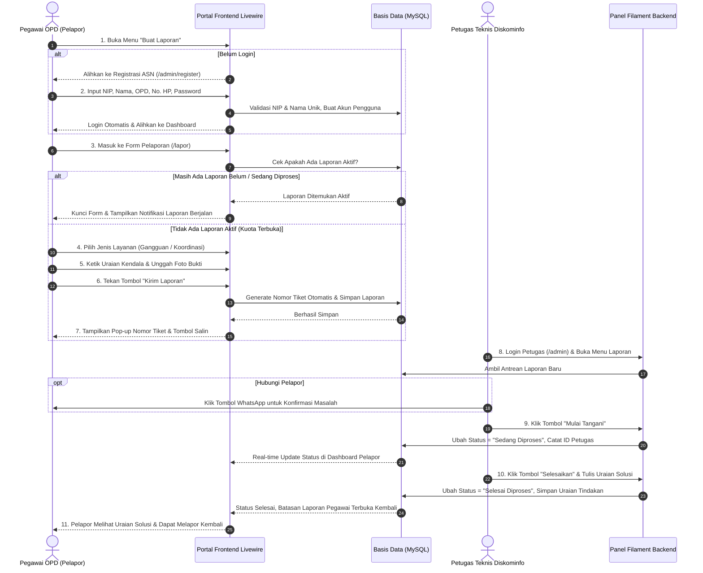

# 📘 EBOOK MANUAL PENGGUNA & DOKUMENTASI TEKNIS
# SISTEM INFORMASI DATA INFRASTRUKTUR TI & LAYANAN PELAPORAN GANGGUAN
### DINAS KOMUNIKASI DAN INFORMATIKA KABUPATEN SIJUNJUNG
**Versi Dokumen:** 2.5 (Edisi Pembaruan Komprehensif)  
**Tahun Rilis:** 2026  
**Alamat Sistem:** [https://infrastruktur.sijunjung.go.id](https://infrastruktur.sijunjung.go.id)

---

## 📑 DAFTAR ISI

1. [BAB I: PENDAHULUAN & PROFIL SISTEM](#bab-i-pendahuluan--profil-sistem)
   - 1.1 Latar Belakang & Landasan Operasional
   - 1.2 Maksud & Tujuan Pengembangan
   - 1.3 Matriks Peran Pengguna (Role-Based Access Control)
2. [BAB II: KATALOG FITUR LENGKAP SISTEM](#bab-ii-katalog-fitur-lengkap-sistem)
   - 2.1 Fitur Pelaporan Masalah & Koordinasi Teknis
   - 2.2 Fitur Validasi Identitas ASN Terintegrasi (NIP & Nama Unik)
   - 2.3 Fitur Anti-Laporan Ganda (Single Active Ticket Constraint)
   - 2.4 Fitur Tracking Tiket Real-Time & Livewire Reactive State
   - 2.5 Fitur Integrasi Direct WhatsApp Petugas
   - 2.6 Fitur Aksi Penanganan Bertahap ("Mulai Tangani" & "Selesaikan")
   - 2.7 Fitur Pemetaan Geospasial Menara BTS (Peta Leaflet Interaktif)
   - 2.8 Fitur Inventarisasi Perangkat Keras & Aset TI OPD
   - 2.9 Fitur Master Wilayah Hierarkis (Kecamatan, Nagari, Jorong)
   - 2.10 Fitur Mode Gelap (Dark Mode) & Proteksi Kontras UI
3. [BAB III: PANDUAN LENGKAP ALUR CARA LAPOR (STEP-BY-STEP USER)](#bab-iii-panduan-lengkap-alur-cara-lapor-step-by-step-user)
   - 3.1 Diagram Alur Pelaporan Pengguna (Visual Sequence)
   - 3.2 Langkah 1: Registrasi Akun ASN Mandiri
   - 3.3 Langkah 2: Masuk ke Sistem (Login)
   - 3.4 Langkah 3: Mengakses Menu "Buat Laporan"
   - 3.5 Langkah 4: Memilih Kategori Layanan Aduan
   - 3.6 Langkah 5: Pengisian Formulir & Unggah Dokumen Bukti
   - 3.7 Langkah 6: Pengiriman Laporan & Penerbitan Nomor Tiket Resmi
   - 3.8 Langkah 7: Pemantauan Progres Status Tiket
   - 3.9 Langkah 8: Penanganan Selesai & Pembukaan Kembali Kuota Laporan
4. [BAB IV: PANDUAN OPERASIONAL PETUGAS & ADMIN (FILAMENT PANEL)](#bab-iv-panduan-operasional-petugas--admin-filament-panel)
   - 4.1 Login Administrator & Operator Teknis (`/admin`)
   - 4.2 Manajemen Antrean Tiket Laporan Masuk
   - 4.3 Menggunakan Fitur Komunikasi WhatsApp Cepat
   - 4.4 Meninjau Detail Laporan (Infolist View)
   - 4.5 Menjalankan Aksi "Mulai Tangani"
   - 4.6 Menyelesaikan Tiket & Menginput Catatan Solusi
   - 4.7 Pengelolaan Data Aset TI, BTS, dan Master Wilayah
   - 4.8 Pengelolaan Akun Pengguna & Reset Password
5. [BAB V: KETERANGAN TEKNIS SISTEM & ARSITEKTUR (TECHNICAL SPECIFICATIONS)](#bab-v-keterangan-teknis-sistem--arsitektur-technical-specifications)
   - 5.1 Stack Teknologi & Spesifikasi Lingkungan Server
   - 5.2 Arsitektur Sistem Hybrid (Filament Backend + Livewire Frontend)
   - 5.3 Algoritma Penomoran Tiket Laporan (Ticket Number Generator)
   - 5.4 State Machine Siklus Hidup Status Laporan (Report Lifecycle)
   - 5.5 Struktur Basis Data & Entitas Utama (Database Entity Design)
   - 5.6 Mekanisme Keamanan Sistem (CSRF, RBAC, XSS Guard, Hash Password)
   - 5.7 Prosedur Pemeliharaan, Kliring Cache & Backup Rutin
6. [BAB VI: PANDUAN PEMECAHAN MASALAH (TROUBLESHOOTING) & FAQ](#bab-vi-panduan-pemecahan-masalah-troubleshooting--faq)
7. [BAB VII: LAYANAN DUKUNGAN & KONTAK DISKOMINFO](#bab-vii-layanan-dukungan--kontak-diskominfo)

---

## 🏛️ BAB I: PENDAHULUAN & PROFIL SISTEM

### 1.1 Latar Belakang & Landasan Operasional
Pemerintah Kabupaten Sijunjung melalui Dinas Komunikasi dan Informatika (Diskominfo) terus berkomitmen mewujudkan tata kelola pemerintahan berbasis elektronik (SPBE) yang bersih, efektif, transparan, dan akuntabel. Kebutuhan operasional jaringan internet dinas, pemeliharaan perangkat keras (hardware), ketersediaan sinyal telekomunikasi, serta penanganan insiden jaringan menuntut adanya wadah terpusat yang dapat diakses secara cepat oleh seluruh Organisasi Perangkat Daerah (OPD).

Aplikasi **Sistem Informasi Data Infrastruktur TI & Layanan Pelaporan Gangguan** hadir sebagai solusi berbasis web untuk:
1. Menginventarisasi seluruh data infrastruktur teknologi informasi pemerintah daerah.
2. Memetakan menara Base Transceiver Station (BTS) secara geospasial di seluruh kecamatan dan nagari.
3. Mengelola pelaporan gangguan jaringan dan koordinasi perbantuan teknis secara transparan dengan SLA (Service Level Agreement) yang terukur.

### 1.2 Maksud & Tujuan Pengembangan
- **Sentralisasi Data:** Seluruh data wilayah, instansi pemerintah (OPD), inventaris perangkat komputer, dan menara BTS tersimpan dalam satu basis data terpadu.
- **Transparansi Penanganan:** Setiap aduan yang diajukan oleh pegawai instansi memiliki nomor tiket resmi dan dapat dilacak status penanganannya secara langsung (*real-time*).
- **Efisiensi Kerja Petugas:** Mengeliminasi koordinasi manual yang tercecer melalui WhatsApp pribadi, menggantikannya dengan sistem antrean tiket terstruktur dan catatan histori tindakan perbaikan.
- **Integritas Akun ASN:** Seluruh pelapor divalidasi berdasarkan Nomor Induk Pegawai (NIP) resmi dan asal instansi yang sah.

### 1.3 Matriks Peran Pengguna (Role-Based Access Control)

| Peran (Role) | Ruang Lingkup Akses | Deskripsi Kewenangan & Hak Akses |
|---|---|---|
| **Super Admin** | Panel Admin `/admin` & Seluruh Portal | Hak akses absolut (CRUD data master, kelola pengguna, ubah role, backup database, audit log, konfigurasi sistem). |
| **Petugas Teknis** | Panel Admin `/admin` & Frontend | Menerima tiket, memulai penanganan (*in-progress*), menginput solusi perbaikan (*resolved*), mengelola data menara BTS & inventaris. |
| **Kepala Bidang TI / Kadis** | Panel Admin `/admin` & Frontend | Supervisi eksekutif, memantau grafik KPI, rasio penyelesaian tiket, dan persebaran infrastruktur wilayah. |
| **Pengguna (Pegawai OPD)** | Portal Frontend Livewire Saja (`/`, `/list-laporan`, `/lapor`) | Melakukan registrasi ASN, login ke portal publik, membuat tiket aduan (1 laporan aktif), dan memantau status tiket miliknya. Dilarang masuk ke `/admin`. |

---

## 🌟 BAB II: KATALOG FITUR LENGKAP SISTEM

### 2.1 Fitur Pelaporan Masalah & Koordinasi Teknis
Sistem menyediakan dua kategori utama layanan yang dapat dipilih oleh instansi:
1. **Laporan Gangguan:** Dikhususkan untuk insiden teknis mendesak seperti internet mati, kabel fiber optic putus, bandwidth ngedrop, printer dinas rusak, atau server aplikasi OPD offline.
2. **Koordinasi Teknis:** Dikhususkan untuk permohonan pendampingan, seperti instalasi jaringan rapat virtual / video conference pimpinan, penataan ruangan server, pemasangan access point baru, atau permohonan konsultasi keamanan informasi.

### 2.2 Fitur Validasi Identitas ASN Terintegrasi (NIP & Nama Unik)
- **Validasi 18 Digit NIP:** Sistem secara otomatis memformat NIP menjadi standar Badan Kepegawaian Negara (`YYYYMMDD YYYYMM X XXX`).
- **Integritas Keunikan (Unique Constraint):** NIP dan Nama ASN dinyatakan unik pada level formulir dan database (`unique:users,nip` dan `unique:users,name`). Hal ini mencegah terjadinya duplikasi akun atau penyalahgunaan identitas pegawai.
- **Normalisasi Nomor Telepon:** Nomor kontak WhatsApp secara otomatis dikonversi ke format internasional baku (`+628...`).

### 2.3 Fitur Anti-Laporan Ganda (Single Active Ticket Constraint)
Untuk menjaga fokus penyelesaian tim teknis Diskominfo dan mencegah terjadinya laporan berulang (*spamming*):
- Sistem memberlakukan aturan **1 Pengguna = Maksimal 1 Laporan Aktif**.
- Apabila seorang ASN masih memiliki tiket dengan status `Belum Diproses` atau `Sedang Diproses`, formulir pembuatan laporan akan otomatis terkunci.
- Tombol "Buat Laporan Baru" pada header navigasi, menu drawer mobile, dan beranda otomatis berubah status menjadi disabled (*"Laporan Diproses"*) dengan ikon gembok pengaman.
- Begitu laporan dinyatakan `Selesai Diproses` oleh petugas, batasan ini otomatis terbuka kembali.

### 2.4 Fitur Tracking Tiket Real-Time & Livewire Reactive State
- Halaman **Daftar Laporan** (`/list-laporan`) dibangun menggunakan teknologi Livewire 3 dengan fitur pencarian instan (*instant live search*), pagination dinamis (6, 12, 24, 48, 100 entri), serta filter status dan filter instansi tanpa perlu me-reload halaman (*zero full-page reload*).
- Pegawai OPD dapat langsung memantau tahapan laporan, nama petugas yang menangani, serta uraian tindakan solusi yang telah dilakukan.

### 2.5 Fitur Integrasi Direct WhatsApp Petugas
- Pada panel admin Filament, setiap baris tiket laporan yang memiliki nomor telepon pelapor dilengkapi tombol hijau resmi WhatsApp.
- Mengklik tombol ini langsung membuka antarmuka WhatsApp Web atau aplikasi seluler WhatsApp dengan teks pengantar resmi yang otomatis terisi nama pelapor dan nomor tiket.
- Petugas lapangan tidak perlu lagi menyimpan nomor kontak pelapor secara manual di buku telepon ponsel.

### 2.6 Fitur Aksi Penanganan Bertahap ("Mulai Tangani" & "Selesaikan")
Untuk menjamin akuntabilitas data, siklus tiket diatur dalam aksi bertahap terpisah:
- **Aksi "Mulai Tangani":** Hanya aktif saat status tiket `Belum Diproses`. Saat diklik oleh petugas, status berubah menjadi `Sedang Diproses` dan sistem secara otomatis mencatat `petugas_id` yang mengambil tanggung jawab aduan tersebut.
- **Aksi "Selesaikan":** Hanya aktif saat status tiket `Sedang Diproses`. Membuka modal formulir wajib untuk menginput uraian teknis tindakan perbaikan. Setelah disimpan, tiket berpindah ke status `Selesai Diproses`.

### 2.7 Fitur Pemetaan Geospasial Menara BTS (Peta Leaflet Interaktif)
- Menampilkan peta persebaran menara telekomunikasi (BTS) di seluruh Kabupaten Sijunjung menggunakan pustaka peta geospasial Leaflet.js dan OpenStreetMap.
- Titik koordinat latitude & longitude diplot dengan pin khusus yang interaktif: saat diklik akan memunculkan popup informasi nama menara, tinggi menara, operator/provider telekomunikasi, jenis konstruksi, dan lokasi jorong/nagari.

### 2.8 Fitur Inventarisasi Perangkat Keras & Aset TI OPD
- Mendokumentasikan inventaris peralatan IT (komputer dinas, switch hub, router mikrotik, server, access point, UPS) milik instansi.
- Dilengkapi pencatatan kondisi perangkat (Baik, Rusak Ringan, Rusak Berat), tahun perolehan, nomor seri/aset, dan penanggung jawab ruangan.

### 2.9 Fitur Master Wilayah Hierarkis (Kecamatan, Nagari, Jorong)
- Struktur data wilayah Kabupaten Sijunjung tersusun hierarkis berelasi (`Kecamatan -> Nagari -> Jorong`).
- Menjamin standarisasi penamaan wilayah pada data menara BTS dan lokasi kantor perangkat daerah.

### 2.10 Fitur Mode Gelap (Dark Mode) & Proteksi Kontras UI
- Sistem mendukung peralihan tema *Light Mode* dan *Dark Mode* yang tersimpan di *Local Storage* peramban pengguna.
- Dilengkapi proteksi styling khusus pada elemen form input (khususnya kolom kata sandi) guna mencegah benturan warna putih akibat fitur *autofill browser* di latar belakang gelap.

---

## 🚀 BAB III: PANDUAN LENGKAP ALUR CARA LAPOR (STEP-BY-STEP USER)

### 3.1 Diagram Alur Pelaporan Pengguna (Visual Sequence)

Berikut adalah diagram alir lengkap dari tahapan pengajuan aduan hingga penyelesaian laporan oleh tim teknis Diskominfo:



---

### 3.2 Langkah 1: Registrasi Akun ASN Mandiri
1. Buka peramban (Google Chrome, Mozilla Firefox, atau Microsoft Edge) dan akses alamat:
   ```txt
   https://infrastruktur.sijunjung.go.id/admin/register
   ```
2. Isi kolom formulir pendaftaran:
   - **Nama Lengkap:** Masukkan nama lengkap beserta gelar kedinasan Anda (Contoh: `Rahmat Hidayat, S.Kom`). Nama tidak boleh sama dengan pengguna lain yang telah terdaftar.
   - **Nomor Induk Pegawai (NIP):** Masukkan 18 digit angka NIP resmi Anda. Sistem akan memformatnya secara rapi menjadi `19890101 201503 1 002`. NIP wajib unik.
   - **Nomor Kontak / WhatsApp:** Masukkan nomor seluler aktif (Contoh: `081267891234`).
   - **Asal OPD:** Pilih instansi atau kantor perangkat daerah tempat Anda bertugas dari menu drop-down.
   - **Email:** Masukkan alamat email kedinasan atau email aktif.
   - **Password & Password Confirmation:** Buat kata sandi minimal 8 karakter.
3. Klik tombol **Daftar / Register**. Anda akan langsung terautentikasi dan diarahkan ke antarmuka aplikasi.

---

### 3.3 Langkah 2: Masuk ke Sistem (Login)
1. Apabila Anda telah memiliki akun terdaftar, klik menu **Masuk** pada header navigasi kanan atau kunjungi:
   ```txt
   https://infrastruktur.sijunjung.go.id/admin/login
   ```
2. Ketikkan email dan password Anda, kemudian tekan **Sign in**.
3. Sistem secara otomatis mendeteksi role Anda sebagai `pengguna` dan mengarahkan Anda ke **Dashboard Daftar Laporan** (`/list-laporan`).

---

### 3.4 Langkah 3: Mengakses Menu "Buat Laporan"
1. Pada navigasi atas (desktop) atau tombol menu drawer (mobile), klik **Buat Laporan**.
2. Anda juga dapat menekan tombol **"Buat Laporan Baru"** yang terletak pada halaman beranda utama website.
3. Sistem akan memeriksa riwayat laporan Anda. Jika Anda tidak memiliki laporan yang sedang diproses, formulir pelaporan akan terbuka secara penuh.

---

### 3.5 Langkah 4: Memilih Kategori Layanan Aduan
Pada formulir pelaporan, tentukan jenis permohonan layanan:
- **Pilihan 1: Laporan Gangguan (Ikon Merah):** Pilih opsi ini jika fasilitas internet, koneksi LAN kantor, perangkat jaringan, atau aplikasi kantor mengalami kerusakan/gangguan operasional.
- **Pilihan 2: Koordinasi Teknis (Ikon Biru):** Pilih opsi ini jika instansi Anda membutuhkan perbantuan teknis dari tim Diskominfo, seperti pendampingan teknis acara zoom meeting pimpinan, instalasi jaringan acara, atau asistensi teknis perangkat.

> *Catatan: Opsi "Kenaikan Bandwidth" telah dinonaktifkan sesuai kebijakan manajemen kapasitas jaringan terpadu Diskominfo Sijunjung.*

---

### 3.6 Langkah 5: Pengisian Formulir & Unggah Dokumen Bukti
1. **Identitas Pelapor & Instansi:** Nama, NIP, OPD, dan nomor telepon Anda akan terisi secara otomatis (*pre-filled*) berdasarkan profil akun login Anda.
2. **Uraian Laporan / Masalah:** Tuliskan penjelasan masalah secara jelas, detail, dan spesifik.
   - *Contoh yang baik:* "Koneksi internet LAN di Ruang Bidang Akuntansi mati total sejak pukul 09.00 WIB. Lampu indikator port switch pada dinding tidak menyala. Sudah dicoba restart router ruangan namun tetap tidak tersambung."
3. **Unggah Foto Bukti Kendala:** Lampirkan foto kondisi perangkat, pesan kesalahan (*error message*) di layar monitor, atau foto fisik kabel/alat yang bermasalah.
   - Format file yang didukung: **JPG, JPEG, PNG, WEBP**.
   - Ukuran berkas maksimal: **5 MB**.

---

### 3.7 Langkah 6: Pengiriman Laporan & Penerbitan Nomor Tiket Resmi
1. Teliti kembali seluruh isian formulir aduan Anda.
2. Tekan tombol biru **"Kirim Laporan"**.
3. Sistem akan memvalidasi data dan memproses penyimpanan ke database.
4. Muncul jendela pop-up dialog **"Laporan Berhasil!"** yang menampilkan **Nomor Tiket Resmi** (Contoh: `261107R4M`).
5. Tekan tombol **Salin Nomor Tiket** (ikon clipboard) untuk menyimpan nomor tiket ke papan klip (*clipboard*) ponsel atau komputer Anda.
6. Anda dapat langsung menekan tombol **"Lihat Daftar Laporan"** untuk memantau tiket Anda.

---

### 3.8 Langkah 7: Pemantauan Progres Status Tiket
Buka menu **Daftar Laporan** (`/list-laporan`) untuk memantau status pengerjaan tiket Anda:
- **🔴 Status "Belum Diproses":** Laporan baru saja masuk ke sistem antrean Diskominfo dan sedang menunggu verifikasi oleh petugas piket.
- **🟡 Status "Sedang Diproses":** Petugas teknis telah ditugaskan dan sedang melakukan penanganan fisik/remote. Pada tabel akan tercantum nama petugas penangan. Anda mungkin akan dihubungi oleh petugas via WhatsApp.
- **🟢 Status "Selesai Diproses":** Masalah telah berhasil ditangani oleh teknisi. Anda dapat membaca rincian solusi pada kolom **Tindakan**.

---

### 3.9 Langkah 8: Penanganan Selesai & Pembukaan Kembali Kuota Laporan
- Begitu tiket laporan Anda diberi status `Selesai Diproses` oleh petugas teknis Diskominfo:
  - Tiket Anda beralih ke arsip riwayat penanganan tuntas.
  - Kuota pelaporan akun ASN Anda otomatis terbuka kembali (*unlocked*).
  - Anda kini dapat mengajukan permohonan layanan atau laporan gangguan baru bila dibutuhkan di masa mendatang.

---

## 🛠️ BAB IV: PANDUAN OPERASIONAL PETUGAS & ADMIN (FILAMENT PANEL)

### 4.1 Login Administrator & Operator Teknis
Petugas teknis dan admin mengakses panel operasional melalui pintu masuk:
```txt
https://infrastruktur.sijunjung.go.id/admin
```
Masukkan kredensial akun kedinasan Diskominfo Anda (Email & Password).

---

### 4.2 Manajemen Antrean Tiket Laporan Masuk
1. Pilih menu **Laporan** pada sidebar navigasi kiri.
2. Seluruh laporan dari OPD disajikan dalam tabel interaktif Filament dengan fitur:
   - **Search Box:** Pencarian nomor tiket, nama pelapor, NIP, atau nama OPD.
   - **Filter Status:** Menyaring laporan berdasarkan `Belum Diproses`, `Sedang Diproses`, atau `Selesai Diproses`.
   - **Filter Tanggal:** Menyaring laporan berdasarkan rentang tanggal masuk.
   - **Sortable Columns:** Pengurutan berdasarkan tanggal tiket terbaru.

---

### 4.3 Menggunakan Fitur Komunikasi WhatsApp Cepat
- Di setiap baris laporan, periksa tombol berikon **WhatsApp (Warna Hijau)**.
- Klik tombol tersebut untuk langsung membuka chat WhatsApp dengan pelapor tanpa perlu mengetik ulang nomor telepon.
- Template pesan resmi yang otomatis terbentuk:
  > *"Halo Bapak/Ibu [Nama Pelapor] dari [Nama OPD], kami dari Tim Teknis Diskominfo Sijunjung menindaklanjuti laporan Anda dengan nomor tiket #[Nomor Tiket] mengenai [Jenis Laporan]. Mohon konfirmasi apakah lokasi dapat kami kunjungi saat ini? Terima kasih."*

---

### 4.4 Meninjau Detail Laporan (Infolist View)
- Klik tombol **Lihat Detail** (ikon mata biru).
- Panel modal Infolist akan menampilkan:
  - Ringkasan Tiket & Waktu Aduan.
  - Data Lengkap Pelapor (Nama, NIP, Jabatan/OPD, No. HP).
  - Uraian Masalah & Foto Dokumentasi Kendala.
  - Nama Petugas Penangan (jika sudah diproses) dan Catatan Tindakan.
- Tindakan ini aman dan tidak merubah status tiket.

---

### 4.5 Menjalankan Aksi "Mulai Tangani"
- Pada baris tiket yang berstatus `Belum Diproses`, klik tombol **Mulai Tangani** (ikon putar/proses oranye).
- Muncul dialog konfirmasi: *"Apakah Anda yakin ingin mulai menangani laporan ini?"*.
- Tekan **Konfirmasi**. Sistem akan:
  1. Mengubah status tiket menjadi `Sedang Diproses`.
  2. Mengunci identitas petugas login sebagai penanggung jawab penanganan.
  3. Memperbarui tampilan dashboard pemohon secara *real-time*.

---

### 4.6 Menyelesaikan Tiket & Menginput Catatan Solusi
- Pada baris tiket yang berstatus `Sedang Diproses`, klik tombol **Selesaikan** (ikon centang hijau).
- Formulir modal penyelesaian akan terbuka:
  - Isi kolom **Keterangan Tindakan**: Tuliskan secara jelas langkah perbaikan yang telah dieksekusi di lapangan (Contoh: *"Pengecekan kabel UTP dropwire, penggantian konektor RJ45 port 3 switch lantai 2, pengujian bandwidth stabil di 50 Mbps"*).
- Tekan tombol **Selesaikan Laporan**.
- Laporan resmi ditutup dengan status `Selesai Diproses`, dan pembatasan pembuatan laporan untuk pemohon terkait otomatis dicabut.

---

### 4.7 Pengelolaan Data Aset TI, BTS, dan Master Wilayah
Petugas berwenang dapat memperbarui data infrastruktur melalui menu sidebar:
1. **Master Wilayah:** Tambah dan perbarui data Kecamatan, Nagari, dan Jorong.
2. **Master OPD:** Tambah dan perbarui daftar Perangkat Daerah, alamat kantor, dan kontak instansi.
3. **Menara BTS:** Kelola data menara telekomunikasi (lokasi, operator penyedia, koordinat Latitude & Longitude, tinggi menara, status operasional).
4. **Peralatan & Inventaris:** Kelola inventaris perangkat keras TI (PC, Laptop, Server, Router, Switch, Aksesoris) per instansi.

---

### 4.8 Pengelolaan Akun Pengguna & Reset Password
- Buka menu **Users** untuk melihat seluruh pengguna terdaftar.
- **Aksi Ganti Password:** Petugas atau Administrator dapat melakukan reset kata sandi pengguna yang lupa password dengan menekan aksi **Ganti Password** (ikon kunci).
- Form ganti kata sandi telah dirancang aman dengan enkripsi otomatis dan bebas dari masalah kontras warna pada mode gelap.

---

## 💻 BAB V: KETERANGAN TEKNIS SISTEM & ARSITEKTUR (TECHNICAL SPECIFICATIONS)

### 5.1 Stack Teknologi & Spesifikasi Lingkungan Server
Sistem dibangun di atas fondasi teknologi web modern berstandar enterprise:
- **Bahasa Pemrograman:** PHP versi 8.2 atau 8.3+.
- **Kerangka Kerja Utama (Framework):** Laravel Framework versi 11.x.
- **Admin Panel Framework:** Filament PHP versi 3.x (Admin Panel, Forms, Tables, Infolists, Notifications).
- **Frontend Reactive Engine:** Livewire versi 3.x & Alpine.js versi 3.x.
- **Desain & Antarmuka:** Tailwind CSS versi 3.4 / 4.x dengan dukungan tema ganda (*Light/Dark theme*).
- **Mesin Basis Data:** MySQL versi 8.0+ atau MariaDB versi 10.4+ dengan *Storage Engine* InnoDB dan *Charset* `utf8mb4_unicode_ci`.
- **Peta Geospasial:** Leaflet.js versi 1.9+ dengan tile OpenStreetMap CartoDB.
- **Web Server:** Nginx 1.24+ atau Apache 2.4+ dengan modul URL Rewrite & PHP-FPM aktif.

---

### 5.2 Arsitektur Sistem Hybrid (Filament Backend + Livewire Frontend)
Sistem menerapkan pemisahan tugas (*Separation of Concerns*) secara ketat:
1. **Area Petugas & Administrator (`/admin`):**
   - Menggunakan ekosistem Filament 3 PHP.
   - Diproteksi oleh middleware autentikasi dan policy gerbang akses `User::canAccessPanel(Panel $panel)`.
   - Mengatur query optimasi `modifyQueryUsing()` dengan *eager loading* relasi (`with(['user', 'opd', 'petugas'])`) untuk mengeliminasi problem N+1 query.
2. **Area Publik & Pegawai OPD (`/`, `/list-laporan`, `/lapor`):**
   - Menggunakan komponen Livewire 3 yang terisolasi dari core panel Filament.
   - Setiap interaksi tabel, filter, dan pagination berjalan secara asinkron (*AJAX / Fetch API*) tanpa memuat ulang seluruh halaman.
   - Hak akses pengguna berstatus role `pengguna` dibatasi hanya pada portal Livewire ini, dan dicegah mengakses `/admin`.

---

### 5.3 Algoritma Penomoran Tiket Laporan (Ticket Number Generator)
Setiap tiket aduan memiliki nomor identifikasi unik (*Unique Ticket Identifier*) yang digenerasikan secara otomatis oleh sistem saat formulir disubmit:

$$\text{Format Tiket} = \text{YYMMDD} + \text{Random Alphanumeric (4 Karakter)}$$

- **YYMMDD:** 2 digit tahun, 2 digit bulan, 2 digit tanggal saat laporan diajukan (Contoh: `261107` untuk 7 November 2026).
- **Random Alphanumeric:** 4 karakter kombinasi huruf kapital dan angka acak bebas dari karakter rancu (Contoh: `R4M9`, `K7A2`).
- **Pemeriksaan Tabrakan (Collision Guard):** Sistem mengeksekusi pengecekan perulangan ke tabel `lapors` untuk memastikan nomor yang dihasilkan belum pernah dipakai sebelumnya sebelum menyimpan record.

---

### 5.4 State Machine Siklus Hidup Status Laporan (Report Lifecycle)
Status laporan merepresentasikan tahapan pemrosesan tiket dengan aturan transisi ketat:

```
[ Belum Diproses ]  ──(Aksi: Mulai Tangani)──>  [ Sedang Diproses ]  ──(Aksi: Selesaikan)──>  [ Selesai Diproses ]
```

1. **State 1: Belum Diproses (Pending):**
   - Tiket baru terdaftar di basis data.
   - Kolom `petugas_id` bernilai `NULL`.
   - Kolom `tindakan` bernilai `NULL`.
   - Tombol aktif di Filament: `WhatsApp`, `Lihat Detail`, `Mulai Tangani`.
   - Kuota pelaporan pemohon: **Terkunci**.
2. **State 2: Sedang Diproses (In-Progress):**
   - Transisi dipicu oleh tombol `Mulai Tangani`.
   - Kolom `petugas_id` terisi otomatis dengan ID akun petugas yang menekan tombol.
   - Tombol aktif di Filament: `WhatsApp`, `Lihat Detail`, `Selesaikan`.
   - Kuota pelaporan pemohon: **Terkunci**.
3. **State 3: Selesai Diproses (Resolved):**
   - Transisi dipicu oleh formulir modal `Selesaikan`.
   - Kolom `tindakan` terisi dengan uraian teknis perbaikan.
   - Tombol aktif di Filament: `WhatsApp`, `Lihat Detail`. Tombol mutasi dinonaktifkan.
   - Kuota pelaporan pemohon: **Terbuka Kembali**.

---

### 5.5 Struktur Basis Data & Entitas Utama (Database Entity Design)

#### 1. Tabel `users` (Pengguna & Pegawai ASN)
- `id` (BigInt, PK, Auto Increment)
- `name` (Varchar, Unique, Not Null)
- `email` (Varchar, Unique, Not Null)
- `nip` (Varchar, Unique, Nullable)
- `no_hp` (Varchar, Nullable)
- `opd_id` (BigInt, FK ke `opds.id`, Nullable)
- `password` (Varchar, Bcrypt Hash)
- `created_at`, `updated_at` (Timestamp)

#### 2. Tabel `lapors` (Tiket Pelaporan Layanan)
- `id` (BigInt, PK, Auto Increment)
- `no_tiket` (Varchar, Unique, Not Null)
- `nama` (Varchar, Not Null)
- `nip` (Varchar, Not Null)
- `no_hp` (Varchar, Not Null)
- `opd_id` (BigInt, FK ke `opds.id`, Not Null)
- `user_id` (BigInt, FK ke `users.id`, Not Null)
- `jenis_laporan` (Enum: `'Laporan Gangguan'`, `'Koordinasi Teknis'`)
- `laporan` (Text, Not Null - Uraian Masalah)
- `status` (Enum: `'Belum Diproses'`, `'Sedang Diproses'`, `'Selesai Diproses'`, Default: `'Belum Diproses'`)
- `tindakan` (Text, Nullable - Solusi Petugas)
- `petugas_id` (BigInt, FK ke `users.id`, Nullable)
- `foto` (Varchar, Nullable - Path Berkas Gambar)
- `created_at`, `updated_at` (Timestamp)

#### 3. Tabel `bts` (Menara Telekomunikasi)
- `id` (BigInt, PK)
- `nama_bts`, `pemilik`, `tinggi_menara`, `latitude`, `longitude`
- `kecamatan_id`, `nagari_id`, `jorong_id` (FK Wilayah)

#### 4. Tabel `inventaris` & `peralatans` (Aset Perangkat TI)
- `id` (BigInt, PK)
- `nama_barang`, `kode_barang`, `kondisi`, `opd_id`, `tahun_perolehan`

---

### 5.6 Mekanisme Keamanan Sistem
1. **CSRF Protection:** Seluruh mutasi HTTP (POST/PUT/DELETE) dilindungi token Cross-Site Request Forgery bawaan Laravel.
2. **Kriptografi Kata Sandi:** Menggunakan hashing satu arah algoritma Bcrypt dengan cost factor adaptif.
3. **Pencegahan SQL Injection:** Seluruh manipulasi basis data menggunakan Parameterized Queries melalui Eloquent ORM.
4. **Pencegahan Cross-Site Scripting (XSS):** Semua output teks pada template Blade diescape secara otomatis (`{{ $variable }}`).
5. **Validasi Berkas Unggahan:** Berkas foto aduan difilter ketat berdasarkan tipe MIME (hanya berkas citra yang diizinkan) serta batas ukuran maksimal 5 MB untuk mencegah serangan denial-of-service / buffer overflow.

---

### 5.7 Prosedur Pemeliharaan, Kliring Cache & Backup Rutin
Untuk menjaga performa sistem tetap optimal:
1. **Perintah Kliring Cache:**
   ```bash
   php artisan optimize:clear
   ```
2. **Perintah Re-cache untuk Mode Produksi:**
   ```bash
   php artisan config:cache
   php artisan route:cache
   php artisan view:cache
   ```
3. **Prosedur Pencadangan Basis Data (Backup):**
   ```bash
   mysqldump -u root -p database_sijunjung > backup_$(date +%Y%m%d).sql
   ```
4. **Pencadangan Berkas Bukti Foto:**
   Cadangkan direktori `storage/app/public/lapor/` secara berkala ke media penyimpanan eksternal atau cloud storage aman.

---

## ❓ BAB VI: PANDUAN PEMECAHAN MASALAH (TROUBLESHOOTING) & FAQ

### Q1: Mengapa NIP saya ditolak saat melakukan pendaftaran?
**Jawaban:** Sistem mewajibkan NIP terdiri dari 18 digit angka sesuai format resmi BKN. Jika muncul notifikasi bahwa NIP sudah terdaftar, artinya Anda telah memiliki akun sebelumnya. Silakan gunakan menu login dengan memasukkan email atau hubungi administrator Diskominfo untuk bantuan reset akun.

### Q2: Mengapa tombol "Buat Laporan Baru" tidak dapat diklik (berstatus disabled)?
**Jawaban:** Hal ini terjadi karena Anda masih memiliki tiket laporan aktif yang berstatus **"Belum Diproses"** atau **"Sedang Diproses"**. Sistem memberlakukan aturan 1 laporan aktif agar petugas dapat menyelesaikan setiap kendala secara fokus. Begitu petugas menyelesaikan laporan Anda, tombol akan aktif kembali.

### Q3: Teks di form kata sandi tidak terbaca saat menggunakan Dark Mode?
**Jawaban:** Masalah ini disebabkan oleh fitur autofill peramban yang menimpa warna latar belakang input menjadi putih. Pada pembaruan terkini, sistem telah menyematkan style anti-autofill berprioritas tinggi. Jika peramban Anda masih menampilkan teks putih, tekan tombol **Ctrl + F5** untuk memuat ulang cache stylesheet.

### Q4: Apakah masyarakat umum non-ASN dapat menggunakan aplikasi ini?
**Jawaban:** Sistem ini dikhususkan secara internal bagi aparatur sipil negara di lingkungan Pemerintah Kabupaten Sijunjung untuk mengelola infrastruktur kantor dan jaringan kedinasan. Untuk laporan keluhan layanan publik umum, masyarakat dapat memanfaatkan portal resmi **SP4N-LAPOR!** ([lapor.go.id](https://www.lapor.go.id)).

---

## 📞 BAB VII: LAYANAN DUKUNGAN & KONTAK DISKOMINFO

Apabila Anda memerlukan asistensi darurat, pelaporan kendala teknis sistem, atau pendampingan akun, silakan menghubungi:

* **Instansi:** Dinas Komunikasi dan Informatika Kabupaten Sijunjung
* **Bidang Teknis:** Bidang Penyelenggaraan E-Government & Infrastruktur Teknologi Informasi
* **Alamat Kantor:** Jl. Prof. M. Yamin, SH No. 1, Muaro Sijunjung, Sumatera Barat 27511
* **Alamat Portal:** [https://infrastruktur.sijunjung.go.id](https://infrastruktur.sijunjung.go.id)
* **Email Resmi:** diskominfo@sijunjung.go.id / kominfo@sijunjung.go.id
* **Jam Operasional Layanan:** Senin s.d. Jumat, Pukul 07.30 – 16.00 WIB

---
*Dokumen ini diterbitkan oleh Dinas Komunikasi dan Informatika Kabupaten Sijunjung. Seluruh hak cipta dilindungi undang-undang.*
