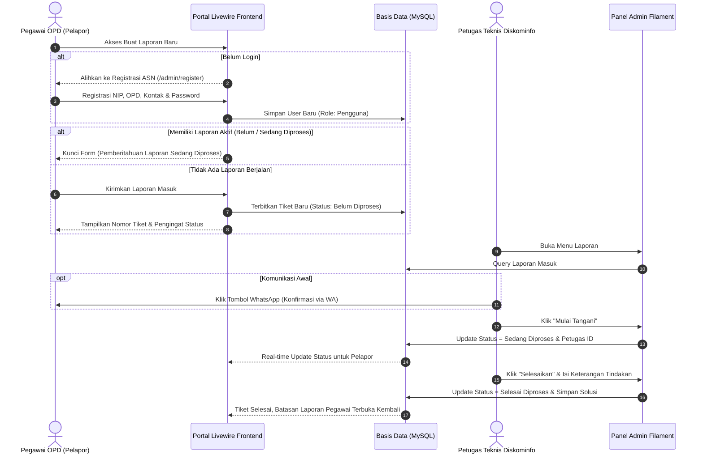

# 📘 EBOOK MANUAL PENGGUNA
# SISTEM INFORMASI DATA INFRASTRUKTUR TI & LAYANAN PELAPORAN GANGGUAN
### DINAS KOMUNIKASI DAN INFORMATIKA KABUPATEN SIJUNJUNG
**Versi Dokumen:** 2.0 (Edisi Pembaruan Terintegrasi)  
**Tahun Rilis:** 2026  
**Alamat Sistem:** [https://infrastruktur.sijunjung.go.id](https://infrastruktur.sijunjung.go.id)

---

## 📑 DAFTAR ISI

1. [BAB I: PENDAHULUAN & GAMBARAN UMUM](#bab-i-pendahuluan--gambaran-umum)
   - 1.1 Latar Belakang & Tujuan
   - 1.2 Karakteristik & Fitur Utama Sistem
   - 1.3 Pembagian Peran Pengguna (Role-Based Access Control)
2. [BAB II: PANDUAN PENGGUNA OPD (PORTAL FRONTEND LIVEWIRE)](#bab-ii-panduan-pengguna-opd-portal-frontend-livewire)
   - 2.1 Pendaftaran Akun ASN Baru (Registrasi Mandiri)
   - 2.2 Prosedur Masuk Sistem (Login)
   - 2.3 Prosedur Pembuatan Laporan Gangguan / Koordinasi Teknis
   - 2.4 Kebijakan Batasan 1 Laporan Aktif (Anti Laporan Ganda)
   - 2.5 Pemantauan Status Tiket Laporan Real-Time
3. [BAB III: PANDUAN OPERATOR & PETUGAS TEKNIS (PANEL FILAMENT BACKEND)](#bab-iii-panduan-operator--petugas-teknis-panel-filament-backend)
   - 3.1 Akses Panel Admin Filament (`/admin`)
   - 3.2 Dashboard & Statistik Pengawasan
   - 3.3 Prosedur Penanganan Tiket Laporan Masuk
     - Tombol Kontak Cepat WhatsApp
     - Tombol Lihat Detail Laporan (Infolist)
     - Tombol Aksi "Mulai Tangani"
     - Tombol Aksi "Selesaikan"
   - 3.4 Manajemen Profil & Fitur Ganti Password Petugas
4. [BAB IV: PANDUAN PENGELOLAAN DATA INFRASTRUKTUR TI & MASTER](#bab-iv-panduan-pengelolaan-data-infrastruktur-ti--master)
   - 4.1 Master Wilayah (Kecamatan, Nagari, Jorong)
   - 4.2 Master Perangkat Daerah (OPD)
   - 4.3 Menara BTS (Base Transceiver Station) & Peta Sebaran
   - 4.4 Manajemen Peralatan IT & Inventaris Barang
   - 4.5 Manajemen User & Hak Akses Akun
5. [BAB V: DIAGRAM ALUR KERJA (WORKFLOW SISTEM)](#bab-v-diagram-alur-kerja-workflow-sistem)
   - 5.1 Siklus Hidup Laporan (Lifecycle Laporan)
6. [BAB VI: PANDUAN PEMECAHAN MASALAH (TROUBLESHOOTING) & FAQ](#bab-vi-panduan-pemecahan-masalah-troubleshooting--faq)
7. [BAB VII: LAYANAN DUKUNGAN & KONTAK DISKOMINFO](#bab-vii-layanan-dukungan--kontak-diskominfo)

---

## 🏛️ BAB I: PENDAHULUAN & GAMBARAN UMUM

### 1.1 Latar Belakang & Tujuan
Aplikasi **Infrastruktur TI Kabupaten Sijunjung** merupakan platform terpadu yang dikembangkan oleh Dinas Komunikasi dan Informatika Kabupaten Sijunjung untuk mendokumentasikan, memetakan, serta mengelola aset infrastruktur teknologi informasi, menara telekomunikasi (BTS), inventaris perangkat keras, serta memfasilitasi pelaporan gangguan jaringan dan koordinasi teknis antar Organisasi Perangkat Daerah (OPD) secara terintegrasi dan akuntabel.

### 1.2 Karakteristik & Fitur Utama Sistem
1. **Keamanan & Validasi ASN:** Setiap pelapor wajib merupakan ASN beridentitas resmi dengan validasi NIP unik 18 digit (`YYYYMMDD YYYYMM X XXX`), nama unik, serta nomor kontak WhatsApp terstandarisasi (`+62`).
2. **Pemisahan Jalur Antarmuka (Interface Segregation):**
   - **Pegawai OPD:** Mengakses antarmuka interaktif **Livewire Frontend** yang cepat, ramah seluler, dan fokus pada pemantauan laporannya sendiri.
   - **Petugas Teknis & Admin:** Mengakses **Panel Filament Backend** untuk pengolahan data master, verifikasi laporan, dan aksi teknis lapangan.
3. **Pencegahan Laporan Ganda (Single Active Ticket Constraint):** Setiap pegawai OPD hanya diizinkan memiliki 1 tiket laporan aktif dalam satu waktu hingga tiket tersebut berstatus *Selesai Diproses*.
4. **Respon Cepat WhatsApp:** Petugas penangan dapat langsung menghubungi pelapor melalui integrasi tautan WhatsApp resmi dalam 1 kali klik.

### 1.3 Pembagian Peran Pengguna (Role-Based Access Control)

| Peran (Role) | Ruang Lingkup Akses | Deskripsi Kewenangan |
|---|---|---|
| **Super Admin** | Panel Admin `/admin` & Frontend | Memiliki kontrol penuh atas seluruh modul data, pengelolaan akun user, manajemen peran/izin, dan backup sistem. |
| **Petugas Teknis** | Panel Admin `/admin` & Frontend | Memvalidasi laporan masuk, mengubah status penanganan, mencatat rincian tindakan penyelesaian, serta mengelola data peralatan dan BTS. |
| **Kepala Bidang TI / Kadis** | Panel Admin `/admin` & Frontend | Melakukan monitoring tingkat eksekutif, rekapitulasi statistik, serta pengawasan kinerja penanganan laporan. |
| **Pengguna (Pegawai OPD)** | Frontend Livewire Saja (`/` & `/list-laporan`) | Melakukan registrasi mandiri, mengajukan laporan gangguan/koordinasi teknis, dan memantau status penyelesaian laporannya sendiri. |

---

## 👤 BAB II: PANDUAN PENGGUNA OPD (PORTAL FRONTEND LIVEWIRE)

### 2.1 Pendaftaran Akun ASN Baru (Registrasi Mandiri)
Bagi ASN di lingkungan Pemerintah Kabupaten Sijunjung yang belum memiliki akun, pendaftaran dilakukan secara mandiri melalui tautan:
```txt
https://infrastruktur.sijunjung.go.id/admin/register
```
Atau cukup menekan tombol **"Buat Laporan Baru"** di halaman beranda web saat belum login.

#### Formulir Pendaftaran Membutuhkan:
1. **Nama Lengkap:** Nama lengkap ASN beserta gelar resmi (harus unik di sistem).
2. **Nomor Induk Pegawai (NIP):** Masukkan 18 digit NIP. Sistem secara otomatis menerapkan format spasi resmi:
   `19820414 200212 1 003`
3. **Asal Perangkat Daerah (OPD):** Pilih instansi tempat Anda bertugas dari daftar pilihan.
4. **Nomor Kontak / WhatsApp:** Masukkan nomor ponsel (misal `081234567890` atau `81234567890`). Sistem secara otomatis membakukan format internasional `+6281234567890`.
5. **Alamat Email:** Email aktif kedinasan atau pribadi.
6. **Password:** Minimal 8 karakter, konfirmasi password dengan benar.

> **Catatan:** Setelah registrasi selesai, sistem akan secara otomatis menetapkan role `pengguna` dan mengarahkan Anda langsung ke Dashboard Laporan.

---

### 2.2 Prosedur Masuk Sistem (Login)
1. Kunjungi menu **Masuk** di pojok kanan atas website, atau akses:
   ```txt
   https://infrastruktur.sijunjung.go.id/admin/login
   ```
2. Masukkan email dan password terdaftar.
3. Klik tombol **Sign in**.
4. Karena Anda berstatus akun ASN/Pengguna, sistem secara otomatis mengarahkan Anda ke dashboard laporan pribadi Anda di `/list-laporan`.

---

### 2.3 Prosedur Pembuatan Laporan Gangguan / Koordinasi Teknis
1. Klik tombol **"Buat Laporan Baru"** di beranda atau header website.
2. Form pelaporan akan otomatis mengenali identitas dan asal OPD Anda:
   - **Jenis Laporan:**
     - 🔴 **Laporan Gangguan:** Kendala jaringan putus, internet lambat, printer error, server lokal mati.
     - 🟡 **Koordinasi Teknis:** Permohonan pendampingan teknis acara/vicon, konfigurasi perangkat, integrasi aplikasi.
   - **Uraian Laporan:** Jelaskan masalah secara spesifik, ruangan/lokasi titik kendala, serta gejala kerusakan.
   - **Foto Laporan:** Unggah foto dokumentasi kendala (opsional, maks. 5MB) dalam format JPG/PNG/PDF.
3. Klik tombol hijau **"Kirim Laporan"**.
4. Sistem akan menerbitkan **Nomor Tiket Unik** (misal: `#261107R4M`) yang dapat disalin sebagai bukti registrasi aduan.

---

### 2.4 Kebijakan Batasan 1 Laporan Aktif (Anti Laporan Ganda)
Untuk menjamin efektivitas penanganan teknis dan menghindari tiket rangkap:
- Pegawai OPD yang memiliki tiket berstatus **"Belum Diproses"** atau **"Sedang Diproses"** **TIDAK DAPAT** membuat laporan baru.
- Halaman form pelaporan dan tombol navigasi di seluruh halaman web otomatis terkunci (disabled) dengan pemberitahuan:
  *"Anda masih memiliki laporan aktif yang sedang diproses. Selesaikan laporan ini sebelum membuat laporan baru."*
- Setelah petugas teknis Diskominfo menuntaskan laporan Anda (status berubah menjadi **"Selesai Diproses"**), tombol pelaporan akan aktif kembali.

---

### 2.5 Pemantauan Status Tiket Laporan Real-Time
Setiap saat, Anda dapat memeriksa progres tiket aduan Anda melalui menu **Daftar Laporan**:
1. Buka tautan `/list-laporan`.
2. Anda hanya akan melihat tiket laporan yang Anda ajukan sendiri.
3. Status laporan ditandai dengan warna badge yang jelas:
   - 🔴 **Belum Diproses:** Laporan baru diterima di sistem, menunggu verifikasi petugas.
   - 🟡 **Sedang Diproses:** Petugas telah ditugaskan dan sedang melakukan investigasi/perbaikan.
   - 🟢 **Selesai Diproses:** Tindakan perbaikan selesai dilakukan beserta catatan solusi dari petugas.

---

## 🛠️ BAB III: PANDUAN OPERATOR & PETUGAS TEKNIS (PANEL FILAMENT BACKEND)

### 3.1 Akses Panel Admin Filament
Petugas teknis dan administrator masuk melalui pintu akses:
```txt
https://infrastruktur.sijunjung.go.id/admin
```
Gunakan akun kedinasan petugas yang telah diberikan oleh Diskominfo Sijunjung.

---

### 3.2 Dashboard & Statistik Pengawasan
Setelah login, petugas disajikan widget indikator kinerja:
- Ringkasan Jumlah Aduan Masuk (Harian & Bulanan).
- Rasio Laporan Selesai vs Dalam Penanganan.
- Persebaran BTS & Aset Infrastruktur Aktif.

---

### 3.3 Prosedur Penanganan Tiket Laporan Masuk
Buka menu **Laporan** pada bilah navigasi kiri. Setiap baris data laporan dilengkapi dengan tombol aksi terpisah yang terstruktur:

```
[ WhatsApp ]  [ Lihat Detail ]  [ Mulai Tangani ]  [ Selesaikan ]
```

#### 1. Tombol WhatsApp (Ikon Hijau Resmi)
- Tombol ini otomatis aktif jika pelapor menyertakan nomor telepon/WhatsApp.
- Mengklik tombol ini akan membuka tab percakapan WhatsApp baru dengan pesan pengantar resmi yang telah disiapkan sistem (berisi salam, nama pelapor, dan nomor tiket rujukan).
- Berguna untuk konfirmasi awal ke pelapor tanpa perlu mengetik ulang nomor telepon di ponsel.

#### 2. Tombol Lihat Detail (Ikon Mata Biru)
- Membuka modal infolist lengkap laporan: Nomor Tiket, Nama Pelapor, Asal OPD, Nomor Kontak, Tanggal Laporan, Jenis Laporan, Uraian Masalah, dan Keterangan Tindakan Petugas.
- **Penting:** Tombol ini murni bersifat peninjauan (view-only) dan tidak menimbulkan efek samping perubahan status laporan.

#### 3. Tombol Aksi "Mulai Tangani" (Ikon Putar Oranye)
- **Kondisi Aktif:** Hanya muncul saat status laporan masih **Belum Diproses**.
- Saat diklik, sistem meminta konfirmasi penanganan:
  *"Mulai menangani laporan #XXXXXX? Status akan diubah menjadi 'Sedang Diproses'."*
- Begitu disetujui:
  - Status laporan otomatis diperbarui menjadi **Sedang Diproses**.
  - Identitas akun petugas yang login otomatis tercatat sebagai `petugas_id`.
  - Pelapor pada dashboard Livewire langsung melihat bahwa aduannya sedang dikerjakan.

#### 4. Tombol Aksi "Selesaikan" (Ikon Centang Hijau)
- **Kondisi Aktif:** Hanya muncul saat laporan berada pada status **Sedang Diproses**.
- Saat diklik, muncul formulir modal tindakan teknis:
  - Masukkan uraian solusi yang telah dilakukan (contoh: *"Penggantian konektor RJ45 port switch LAN di Ruang Rapat Bappeda, koneksi internet normal kembali"*).
- Klik tombol **Selesaikan**:
  - Status laporan resmi menjadi **Selesai Diproses**.
  - Catatan tindakan tersimpan rapi dan dapat dibaca oleh pelapor.
  - Batasan pengajuan laporan untuk pegawai pelapor tersebut otomatis terbuka kembali.

---

### 3.4 Manajemen Profil & Fitur Ganti Password Petugas
Petugas dapat memperbarui kata sandi akunnya secara berkala melalui menu **Users**:
1. Temukan nama Anda, klik aksi **Ganti Password** (Ikon Kunci).
2. Masukkan Password Baru dan Konfirmasi Password.
3. Form telah dioptimalkan dengan perlindungan kontras tinggi pada dark mode dan pencegahan autofill browser yang tidak diinginkan.
4. Klik **Simpan Password**.

---

## 🌐 BAB IV: PANDUAN PENGELOLAAN DATA INFRASTRUKTUR TI & MASTER

### 4.1 Master Wilayah (Kecamatan, Nagari, Jorong)
- **Kecamatan:** Mengelola 8 kecamatan di Kabupaten Sijunjung.
- **Nagari:** Mengelola data nagari pada tiap kecamatan. Kolom `jumlah_penduduk_nagari` secara otomatis dihitung dan diperbarui dari akumulasi seluruh jorong dalam nagari terkait.
- **Jorong:** Mengelola data jorong dan jumlah penduduk per jorong.

### 4.2 Master Perangkat Daerah (OPD)
Mengelola daftar seluruh dinas, badan, kantor, dan kecamatan di Kabupaten Sijunjung yang menjadi entitas pelapor dan penempatan aset TI.

### 4.3 Menara BTS (Base Transceiver Station) & Peta Sebaran
- Mengelola data menara telekomunikasi: nama tower, provider penyedia (Telkomsel, Indosat, XL, dll), jenis menara (Monopole/Lattice), tinggi menara, serta koordinat geografis (Latitude & Longitude).
- Data yang diinputkan langsung terintegrasi dengan **Peta BTS Interaktif** berbasis Leaflet pada menu navigasi publik.

### 4.4 Manajemen Peralatan IT & Inventaris Barang
- Pencatatan aset perangkat keras (server, router mikrotik, switch manageable, access point, PC).
- Pemantauan masa garansi, tahun perolehan, kondisi fisik (Baik, Rusak Ringan, Rusak Berat), dan riwayat mutasi penempatan.

---

## 🔄 BAB V: DIAGRAM ALUR KERJA (WORKFLOW SISTEM)

Berikut adalah diagram alur penanganan tiket laporan gangguan dan koordinasi teknis dari awal hingga tuntas:



---

## ❓ BAB VI: PANDUAN PEMECAHAN MASALAH (TROUBLESHOOTING) & FAQ

### Q1: Mengapa NIP saya ditolak saat melakukan registrasi?
**Jawaban:** Pastikan NIP yang dimasukkan terdiri dari 18 digit angka sesuai dengan format BKN (`YYYYMMDD YYYYMM X XXX`). Jika NIP sudah pernah didaftarkan sebelumnya, Anda cukup melakukan login menggunakan email/password yang telah terdaftar.

### Q2: Mengapa tombol "Buat Laporan Baru" tidak bisa diklik / berstatus disabled?
**Jawaban:** Sistem memberlakukan aturan 1 laporan aktif per pengguna. Periksa menu **Daftar Laporan**, pastikan laporan Anda sebelumnya telah berstatus **Selesai Diproses**. Jika laporan masih berstatus Belum atau Sedang Diproses, mohon menunggu tim teknis menyelesaikan aduan tersebut terlebih dahulu.

### Q3: Teks di form kata sandi tidak terlihat saat menggunakan Dark Mode?
**Jawaban:** Pembaruan antarmuka terbaru telah mengatasi kontras teks otomatis. Pastikan browser Anda tidak memaksakan autofill eksternal yang bertentangan atau lakukan refresh dengan menekan `Ctrl + F5`.

### Q4: Apakah masyarakat umum non-ASN dapat membuat laporan?
**Jawaban:** Sistem ini dikhususkan bagi aparatur sipil negara di lingkungan Pemerintah Kabupaten Sijunjung untuk gangguan fasilitas kantor dan koordinasi antar OPD. Masyarakat umum dapat memanfaatkan kanal pengaduan resmi SP4N-LAPOR!.

---

## 📞 BAB VII: LAYANAN DUKUNGAN & KONTAK DISKOMINFO

Apabila Anda mengalami kendala operasional yang membutuhkan bantuan darurat atau eskalasi teknis tingkat lanjut, silakan menghubungi:

* **Instansi:** Dinas Komunikasi dan Informatika Kabupaten Sijunjung
* **Bidang:** Penyelenggaraan E-Government & Infrastruktur TI
* **Alamat Kantor:** Jl. Prof. M. Yamin, SH No. 1, Muaro Sijunjung, Sumatera Barat
* **Portal Layanan:** [https://infrastruktur.sijunjung.go.id](https://infrastruktur.sijunjung.go.id)
* **Email Resmi:** diskominfo@sijunjung.go.id / kominfo@sijunjung.go.id
* **Jam Kerja:** Senin – Jumat, Pukul 07.30 – 16.00 WIB

---
*© 2026 Dinas Komunikasi dan Informatika Kabupaten Sijunjung. Seluruh hak cipta dilindungi undang-undang.*
